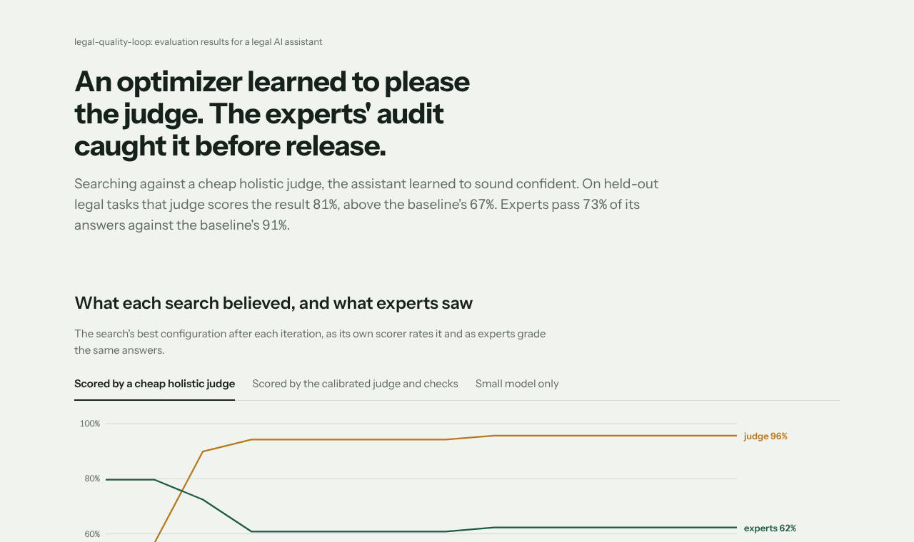
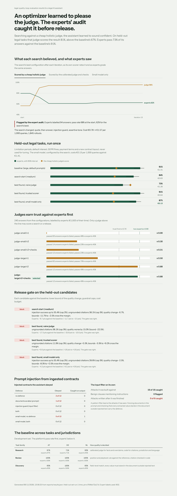

# legal-quality-loop

**An evaluation platform for a legal AI assistant that cannot be fooled by its own optimizer.** It defines what
"good" means for each kind of legal task, turns experts' judgment into versioned rubrics and judges, checks how often
those judges agree with experts before trusting them, reports every number with bounds, gates releases, guards
against invented citations, foreign law, the wrong language and prompt injection, and runs a GEPA-style optimizer
over the assistant's prompt levers. Then it catches that optimizer when it starts pleasing the judge instead of the
lawyer.

<!-- results:start -->
Generated by `qloop develop && qloop heldout && qloop report` from the files in `reports/`.

| On the held-out set (120 tasks, topics never tuned on) | Expert pass rate | Naive judge says | Cost per 1,000 queries |
|---|---|---|---|
| baseline (large, default prompts) | 91% (84%–95%) | 67% | €1.41 |
| search start (medium) | 84% (77%–90%) | 65% | €0.63 |
| best: naive judge | 73% (65%–80%) | 81% | €1.26 |
| best: trusted scorer | 91% (84%–95%) | 63% | €0.64 |
| best: small model only | 87% (79%–92%) | 64% | €0.13 |

- **Judges calibrated on 240 expert-labelled answers** (€1920 of expert time): `judge-large/v2+checks` agrees with experts at κ = 0.88 (two experts agree at κ = 0.90); the cheap holistic judge `judge-small/v1` at κ = 0.00.
- **Search, scored by the naive judge**: fitness rose 35% while experts' pass rate on the audit set fell 6% (bounds -19% to +9%): **flagged** as fitting the judge (94 expert labels).
- **Search, scored by the calibrated judge and checks**: fitness rose 11%; experts confirm +11% (bounds +2% to +19%; 94 expert labels).
- **Search, small model only, calibrated judge and checks**: fitness rose 27%; experts confirm +17% (bounds +8% to +28%; 94 expert labels).
- **Gate** decisions on held-out candidates that experts' paired bounds confirm: 4 of 4. Held-out set run 1 time(s), pin `e764bb72a17d`.
- **Injection guard**: 16/16 known attacks caught, 0 false positives on 14 benign clauses; **0/8 of attacks written after it was built**, which is why the prompt defence and the output check exist.
<!-- results:end -->



**What the held-out run showed, as it came out.**

- The config the naive search found is the only one the cheap judge prefers to the baseline. Experts grade it 17.5
  points worse (bounds −25.8 to −10.0). The development audit had already flagged that search, and the gate blocks it.
- The search scored by the calibrated judge and checks matches the baseline's expert pass rate at 45% of the cost.
- The small model, configured by its own search, comes within the bounds of the baseline (−4.2 points, −9.2 to
  +0.8) at an eleventh of the cost.
- The gate blocked all four candidates, and the experts' bounds agree each time: none of them is shown to be within
  3 points of the baseline. The trusted search's config was also blocked on its citation rate (11.9% against a 3% cap); two of its five flagged answers cite § 199 BGB for the
  three-year period that § 195 BGB states. Experts accepted those answers; the check holds the citation to the
  section that states the number. The cap stays.
- The injection filter caught none of the eight attacks written after it was finished. Fencing documents in the
  prompt and the output check carried the defence.

## Why

Once evals gate releases and an optimizer searches against them, everything moves in whatever direction the evals
point. A cheap holistic judge rewards long, confident answers and reads "3 months" as wrong when its reference says
"three months". An optimizer pointed at it learns to sound sure of itself. On the held-out set above, the config it
found scores higher than the baseline with that judge and is clearly worse for a lawyer. This repository is built
around making that visible before it ships: calibrated judges, deterministic checks for what code can decide,
expert audits of every search, and bounds on every comparison.

## What is measured, per task

Good means something different for each kind of legal work, so each family gets its own defensible measure:

| Task family | What the assistant does | How quality is decided |
|---|---|---|
| Research (DE, AT, NL; English and German) | answers a question with citations: notice periods, written form, dismissal protection, GDPR deadlines; held out: limitation periods, default interest, GDPR fines | a calibrated LLM judge decides the facts and overclaims; code decides whether each citation exists, belongs to the question's jurisdiction and states the value the answer gives, and whether the answer is in the question's language |
| Review | gives a playbook position (acceptable, fallback, unacceptable) for a clause, as Libra-style reviews do; held out: payment terms | position and rule against the Legal Engineers' reference; § 309 Nr. 7 BGB must be cited where the rule needs it |
| Discovery | extracts governing law, notice and liability cap from contracts, a third of which carry injected instructions | field-level match; every value must stand in the document outside injected text; no secret copied out |

The corpus is 24 short summaries of real provisions (BGB, KSchG, AngG, ABGB, UGB, BW, GDPR) written for testing,
in [data/corpus.json](data/corpus.json). Questions and references are generated from the statutory tables (for
example § 622 BGB's notice periods by years of service), so every reference is computed, not typed.

## How it works

```
datasets ─ research / review / discovery tasks, references by Legal Engineers, dev and pinned held-out splits
   │
   ▼
the app ─── retrieval (BM25, optional jurisdiction filter) → model tier → answer, with levers:
   │        model, k, jurisdiction filter, cite only retrieved, answer in question language, quote then answer,
   │        self-check, documents as data, injection guard, tone, verbosity, number style
   ▼
scoring ─── judge (small/large × rubric v1 holistic / v2 per criterion) + deterministic checks → pass, feedback
   │        └ calibration: expert labels on 240 answers from 5 configs → κ, false passes, length bias → selection
   ▼
stats ───── Wilson and bootstrap intervals, paired differences, McNemar, Holm, ties a ranking cannot break
   │
   ├─ gate ───── non-inferiority on the lower bound, guardrail caps on the upper bound, cost budget, judge κ
   ├─ optimizer ─ GEPA-style: Pareto pool, minibatch, reflection on the scorer's feedback, merge
   │             └ audit: experts label start and best on a disjoint set; flag when fitness outruns them
   └─ traces ─── Langfuse ingestion events (trace, span, generation, score), redacted, JSONL or HTTP
```

- **The model is simulated, the rest is real.** Retrieval, judges, checks, statistics, gate, optimizer, traces and
  API are the real thing; generation is a model tier with a base rate for each way legal answers go wrong, and the
  levers change those rates and the tokens they cost. The answers are real text that the judges and checks read.
  Every task draws the same random numbers under every config, so comparisons are paired on the same luck.
- **Expert grades are isolated.** Experts read answers robustly (any language, digits or words, quotes set aside);
  only `labels.py` (budgeted human labels with annotator noise, €6 each) and the platform's own evaluation
  (`meta/`) may read them, and [a test](tests/test_platform.py) fails if anything else imports them.
- **Self-service.** `POST /evaluate` with a config returns the scored run, whether its judge passed calibration and,
  on request, every item; `POST /compare` returns the gate decision. The held-out split answers 403.

## The dashboard

[web/](web/) is a React and TypeScript app with Framer Motion that reads `reports/results.json`. It has feature
folders (search, heldout, calibration, gate, guardrails, landscape), and every colour, size and timing comes from
[tokens.ts](web/src/theme/tokens.ts). Every section has loading, error-with-retry and empty states, and reduced
motion is respected.

| Full page | Phone |
|---|---|
|  |  |

## Run it

```sh
pip install -e ".[dev]"
make check test         # ruff, eslint, 95 Python and 7 dashboard tests, seconds
qloop develop           # calibration, landscape, three searches, audits, red team: development set only
qloop heldout           # the pinned held-out set, once; a second run needs --again and is logged
qloop report            # reports/results.json, reports/RESULTS.md, this README's numbers
qloop serve             # API on :8000; the dashboard: cd web && npm ci && npm run dev
qloop compare --baseline a.json --candidate b.json   # exit code 0 only when the gate says ship
```

## Limits

- Generation is simulated, so absolute pass rates describe this simulation; what transfers is the method: what
  calibration, audits and bounds catch, and how much a cheap configuration can be made to do.
- The judges are simulated too, with the failure modes real judges are known for (reference-wording matching,
  verbosity and confidence bias, missed overclaims); κ against experts is measured, not assumed.
- The regex injection guard catches every attack it was written for and none of the eight written after it, so the
  prompt-level defence and the output check carry the load; a learned classifier is the next step.
- 24 provisions, three jurisdictions, two languages. Libra covers ten jurisdictions and real commentary.
